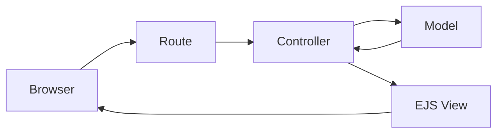

# Express MVC Boilerplate

A minimal, beginner-friendly MVC application using Node.js, Express, EJS, MongoDB, and Mongoose. It renders a home page and a list of users from MongoDB.

## MVC in this project

- **Model:** `models/User.js` defines user data and validation.
- **View:** EJS files in `views/` render HTML.
- **Controller:** Files in `controllers/` fetch data and render views.



## Structure

```text
config/db.js             MongoDB connection
models/User.js           User model
controllers/             Request handlers
routes/                  Express routes
views/                   EJS pages and partials
public/css/style.css     Plain CSS
app.js                   Application entry point
```

## Setup

```bash
npm install
cp .env.example .env
```

Set your MongoDB URL in `.env`:

```env
PORT=3000
MONGODB_URI=your-mongodb-connection-url
```

The server starts only after MongoDB connects. If `MONGODB_URI` is missing, it exits with a clear error. `.env` is ignored by Git.

## Run

```bash
npm start
npm run dev
npm run seed
```

Open `http://localhost:3000`. The available routes are `GET /` and `GET /users`. Unknown routes show a simple 404 page.

`npm run dev` uses Nodemon to restart the server automatically when files change.

Run `npm run seed` after configuring MongoDB to insert the example users. Existing users are matched by email and skipped, so the command is safe to run more than once.

## Reusable partials

Pages include `views/partials/header.ejs`, `navbar.ejs`, and `footer.ejs` with EJS `include()`. Add shared markup there once, and every page can reuse it.

## Add a feature

1. Add a schema and export it from `models/`.
2. Add controller functions that use the model and call `res.render()`.
3. Add an EJS page under `views/`, using the partials.
4. Register a route in `routes/index.js` that points to the controller.

The request flow is: **Browser → Route → Controller → Model → Controller → EJS View → Browser**.

## Credit

Created by **Pollock Nag**.


